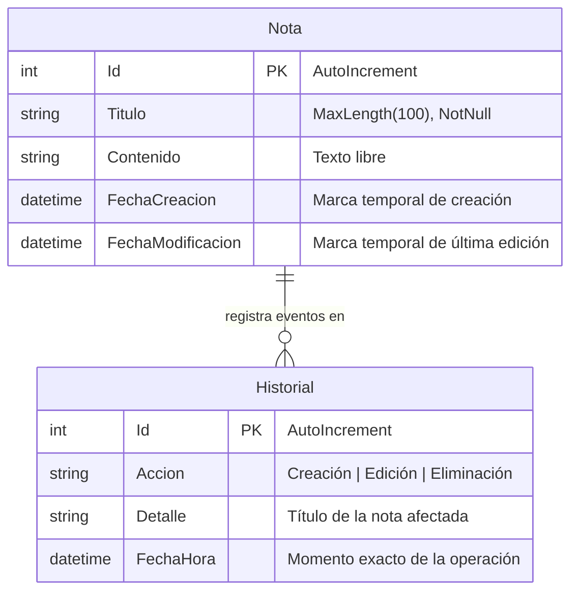
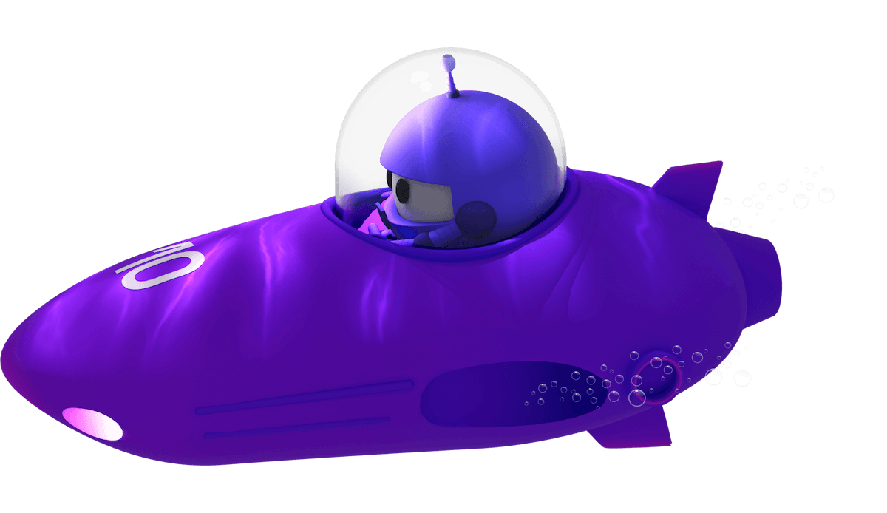

# 📱 NotasAppSQLite - Aplicación Integradora en .NET MAUI

Aplicación móvil y de escritorio multiplataforma desarrollada en **.NET MAUI** (.NET 10) con persistencia local en **SQLite**, arquitectura desacoplada **MVVM (Model-View-ViewModel)** mediante **CommunityToolkit.Mvvm** y navegación jerárquica con pestañas a través de **.NET MAUI Shell**.

---

## 🏗️ 1. Estructura del Proyecto

El proyecto está organizado siguiendo el estándar de arquitectura limpia y separación de responsabilidades:

```text
NotasAppSQLite/
├── Models/
│   ├── Nota.cs                  # Entidad para las notas
│   └── Historial.cs             # Entidad para la bitácora de auditoría
├── Services/
│   └── NotasDatabase.cs         # Servicio asíncrono SQLite con lazy-init y operaciones CRUD
├── ViewModels/
│   ├── NotasViewModel.cs        # Lógica de presentación, búsqueda y acciones de notas
│   ├── DetalleNotaViewModel.cs  # Validación y persistencia (creación/edición)
│   └── HistorialViewModel.cs    # Consulta y presentación de eventos del historial
├── Views/
│   ├── NotasPage.xaml           # Pantalla principal con SearchBar, CollectionView y FAB
│   ├── NotasPage.xaml.cs
│   ├── DetalleNotaPage.xaml     # Formulario de alta/edición con validación visual
│   ├── DetalleNotaPage.xaml.cs
│   ├── HistorialPage.xaml       # Registro cronológico de actividades
│   └── HistorialPage.xaml.cs
├── Resources/                   # Fuentes, imágenes, splash screen e iconos
├── docs/                        # Capturas y documentación gráfica
├── AppShell.xaml                # Configuración de Shell y TabBar
├── AppShell.xaml.cs             # Registro de rutas de navegación
├── MauiProgram.cs               # Configuración del host e Inyección de Dependencias (DI)
├── NotasAppSQLite.csproj        # Archivo de configuración del proyecto .NET MAUI
└── README.md                    # Documentación del proyecto
```

---

## 🗄️ 2. Modelo de Datos y Persistencia

La persistencia se realiza localmente mediante **SQLite-net-pcl**, almacenando el archivo de base de datos en `FileSystem.AppDataDirectory/notas_app.db3`.

### Diagrama de Entidad-Relación (Mermaid)



### Entidades

- **Nota (`Models/Nota.cs`)**:
  - `Id`: Llave primaria autoincremental (`[PrimaryKey, AutoIncrement]`).
  - `Titulo`: Título de la nota con longitud máxima de 100 caracteres y restricción de no nulidad (`[MaxLength(100), NotNull]`).
  - `Contenido`: Cuerpo de texto de la nota.
  - `FechaCreacion`: Fecha y hora en que se creó la nota.
  - `FechaModificacion`: Fecha y hora de última modificación.

- **Historial (`Models/Historial.cs`)**:
  - `Id`: Llave primaria autoincremental.
  - `Accion`: Tipo de operación realizada (`Creación`, `Edición` o `Eliminación`).
  - `Detalle`: Título de la nota sobre la cual se ejecutó la acción.
  - `FechaHora`: Registro cronológico del evento.

---

## ⚙️ 3. Arquitectura y Componentes Clave

### A. Servicio de Base de Datos (`Services/NotasDatabase.cs`)
- **Inicialización Asíncrona (Lazy-Loading)**: Implementa un bloqueo seguro (`SemaphoreSlim`) para inicializar la conexión `SQLiteAsyncConnection` y crear las tablas sólo cuando se realiza la primera consulta.
- **Operaciones CRUD para Notas**:
  - `GetNotasAsync()`: Obtiene todas las notas ordenadas descendentemente por fecha de modificación.
  - `BuscarNotasPorTituloAsync(string query)`: Búsqueda dinámica con consulta SQL parametrizada (`LIKE ?`).
  - `GetNotaByIdAsync(int id)`: Recuperación puntual de una nota por su identificador.
  - `SaveNotaAsync(Nota nota)`: Inserción (`InsertAsync`) si `Id == 0` o actualización (`UpdateAsync`) si `Id != 0`.
  - `DeleteNotaAsync(Nota nota)`: Eliminación de la nota.
- **Auditoría e Historial**:
  - `RegistrarAccionAsync(string accion, string detalle)`: Registro inmediato de toda acción.
  - `GetHistorialAsync()`: Listado de eventos ordenados descendentemente por fecha.

### B. Arquitectura MVVM con CommunityToolkit.Mvvm
- Uso de generadores de código de alto rendimiento: `[ObservableProperty]` con propiedades parciales C# 13 compatibles con AOT/WinRT y `[RelayCommand]`.
- **NotasViewModel**:
  - `Notas`: Colección observable (`ObservableCollection<Nota>`).
  - `TextoBusqueda`: Propiedad enlazada a la barra de búsqueda con filtrado reactivo.
  - `CargarNotasCommand`, `BuscarCommand`, `CrearNotaCommand`, `EditarNotaCommand` y `EliminarNotaCommand` (con confirmación modal `DisplayAlertAsync`).
- **DetalleNotaViewModel**:
  - Atributo de navegación Shell `[QueryProperty(nameof(NotaId), "id")]`.
  - Validación en tiempo real del título (no vacío y máximo 100 caracteres) con flags visuales (`TieneErrorTitulo`).
  - `GuardarNotaCommand`: Inserta o actualiza la nota, registra el historial y regresa con `Shell.Current.GoToAsync("..")`.
- **HistorialViewModel**:
  - `ListaHistorial`: Colección observable (`ObservableCollection<Historial>`).
  - `CargarHistorialCommand`: Refresca la auditoría cronológica.

### C. Navegación con Shell (`AppShell.xaml` y `AppShell.xaml.cs`)
- **TabBar** con dos pestañas principales:
  1. `Tab "Notas"` -> `Views/NotasPage`
  2. `Tab "Historial"` -> `Views/HistorialPage`
- **Ruta Registrada**:
  ```csharp
  Routing.RegisterRoute(nameof(Views.DetalleNotaPage), typeof(Views.DetalleNotaPage));
  ```

### D. Inyección de Dependencias (`MauiProgram.cs`)
- Configuración de `NotasDatabase` como **Singleton**.
- Registro de ViewModels y Páginas como **Transient** para garantizar ciclos de vida limpios y desvinculación de memoria.

---

## 🖼️ 4. Capturas de Pantalla

A continuación se presentan las interfaces principales de la aplicación:

### Lista de Notas y Búsqueda


### Creación y Edición de Nota (Validación)


### Bitácora de Historial


---

## 🚀 5. Compilación y Ejecución

### Requisitos previos:
- .NET 10 SDK
- Carga de trabajo .NET MAUI (`dotnet workload install maui`)

### Comandos:
```bash
# Restaurar dependencias
dotnet restore

# Compilar para Windows
dotnet build -f net10.0-windows10.0.19041.0

# Compilar para Android
dotnet build -f net10.0-android

# Ejecutar en Windows
dotnet run -f net10.0-windows10.0.19041.0
```
